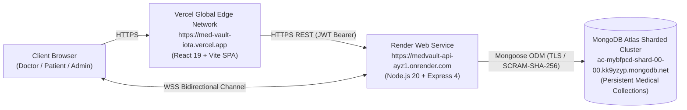

# MedVault — Production Deployment & Cloud Infrastructure Guide

**Platforms:** Vercel (Frontend) & Render (Backend)  
**Database:** MongoDB Atlas (Cloud Persistent Cluster)  
**Real-Time Engine:** Socket.IO WebSockets  
**Repository:** `https://github.com/Shanaya1201/MedVault`  

---

## 1. Cloud Architecture Overview

MedVault uses a decoupled micro-architecture deployed across specialized cloud infrastructure:



---

## 2. Frontend Deployment: Vercel

### Service URL
- **Production URL:** `https://med-vault-iota.vercel.app`

### Configuration Settings
- **Framework Preset:** Vite
- **Root Directory:** `client`
- **Build Command:** `npm run build`
- **Output Directory:** `dist`
- **Install Command:** `npm install`

### Environment Variables on Vercel
Set the following environment variables in the Vercel Dashboard under **Project Settings > Environment Variables**:

| Variable Name | Production Value | Purpose |
|---|---|---|
| `VITE_API_URL` | `https://medvault-api-ayz1.onrender.com` | Base URL for REST API requests |
| `VITE_SOCKET_URL` | `https://medvault-api-ayz1.onrender.com` | URL for Socket.IO WebSocket handshake |

> [!IMPORTANT]
> Both variable names begin with the `VITE_` prefix required by Vite to expose them to client-side code during compilation.

---

## 3. Backend Deployment: Render

### Service URL
- **Production URL:** `https://medvault-api-ayz1.onrender.com`
- **Health Check Endpoint:** `https://medvault-api-ayz1.onrender.com/api/health`

### Configuration Settings
- **Service Type:** Web Service
- **Runtime:** Node
- **Root Directory:** `server`
- **Build Command:** `npm install`
- **Start Command:** `node server.js`
- **Auto-Deploy:** Enabled (triggers automatically on push to `main`)

### Environment Variables on Render
Set the following environment variables in the Render Dashboard under **Environment**:

| Variable Name | Recommended Production Value | Description |
|---|---|---|
| `NODE_ENV` | `production` | Enables production optimizations |
| `PORT` | `5000` (or leave default assigned by Render) | HTTP & WebSocket port |
| `CLIENT_URL` | `https://med-vault-iota.vercel.app` | Allowed CORS origin |
| `JWT_SECRET` | `<Secure_Random_256bit_String>` | Secret used for HMAC signing of JWT tokens |
| `JWT_EXPIRES_IN` | `7d` | Token lifetime |
| `MONGODB_URI` | `mongodb+srv://<user>:<password>@cluster0.kk9yzyp.mongodb.net/test?retryWrites=true&w=majority` | MongoDB Atlas connection string |
| `RATE_LIMIT_WINDOW_MS` | `900000` | Rate limiting window (15 minutes) |
| `RATE_LIMIT_MAX` | `500` | Max requests per IP within window |
| `EMAIL_NOTIFICATIONS_ENABLED` | `false` (or `true` with SMTP) | Toggles transactional email alerts |
| `WHATSAPP_NOTIFICATIONS_ENABLED` | `false` (or `true` with Meta token) | Toggles Meta WhatsApp Cloud alerts |
| `WHATSAPP_VERIFY_TOKEN` | `medvault_webhook_verify_token_2026` | Webhook verification challenge token |

---

## 4. Production Security & Data Safeguards

1. **Strict CORS Policy:**
   Render only permits origins matching `https://med-vault-iota.vercel.app` and `.onrender.com` subdomains in production. Wildcard origins (`*`) are disallowed.
2. **Persistent MongoDB Atlas Shard:**
   Render connects directly to the production cluster `ac-mybfpcd-shard-00-00.kk9yzyp.mongodb.net`. In-memory fallbacks are prohibited.
3. **Zero Secrets in Source Control:**
   Neither `server/.env` nor `client/.env` are committed. Only template `.env.example` files containing non-sensitive placeholders exist in the repository.

---

## 5. Verification Commands for Live Deployment

```bash
# 1. Verify live backend health and Atlas database connection
curl https://medvault-api-ayz1.onrender.com/api/health

# 2. Verify live frontend loads with HTTP 200
curl -I https://med-vault-iota.vercel.app/

# 3. Verify WhatsApp service status
curl https://medvault-api-ayz1.onrender.com/api/whatsapp/status

# 4. Run automated live production verification
node server/scripts/verifyProductionLive.js
```
