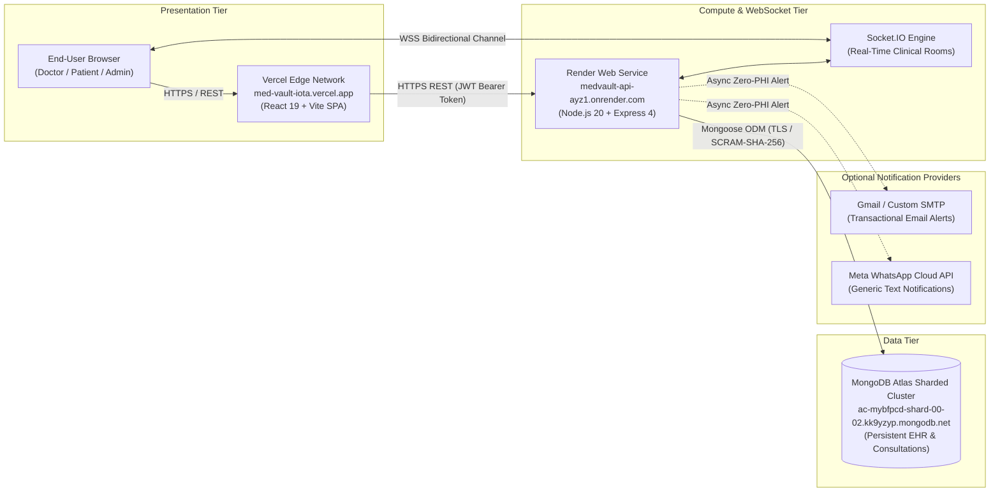
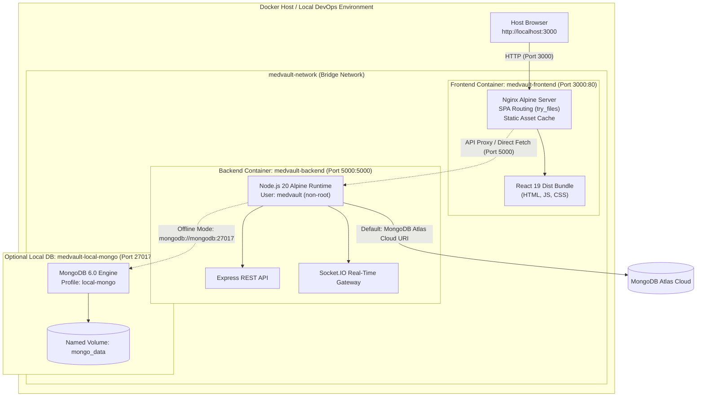

# Experiment 10 — Deploy Full-Stack Apps Using DevOps Tools and Docker

**Course / Lab Curriculum:** Full-Stack Web Development & Cloud DevOps  
**Application:** MedVault — Clinical Healthcare Management & Live Telehealth Hub  
**Student Implementation:** Multi-Stage Docker Containerization, Orchestration & Production Deployment  
**Status:** Complete & Verified  

---

## 1. Experiment Overview & Objectives

The primary objective of Experiment 10 is to containerize a full-stack production application (MERN stack with WebSockets) using modern DevOps methodologies, multi-stage Docker builds, and Docker Compose orchestration.

### Specific Objectives:
1. **Multi-Stage Containerization:** Create production-grade Dockerfiles for both frontend (React + Vite + Tailwind CSS) and backend (Node.js + Express + Socket.IO).
2. **Container Security & Least Privilege:** Enforce non-root user execution (`USER medvault`), minimal alpine base images, and strict layer hygiene.
3. **Multi-Container Orchestration:** Compose backend, frontend, and database services in `docker-compose.yml` with bridge networking and health checks.
4. **Data Isolation & Atlas Preservation:** Retain production MongoDB Atlas connectivity as default while providing an isolated `local-mongo` compose profile for offline local development, preventing accidental database wipes.
5. **Multi-Channel Notification Integration:** Complement existing real-time WebSocket clinical chats with decoupled, asynchronous email (SMTP/Gmail) and WhatsApp notifications.
6. **Continuous Delivery:** Maintain zero-downtime, synchronized deployment workflows targeting Vercel (Frontend), Render (Backend), and MongoDB Atlas (Database).

---

## 2. Architecture Diagrams

### A. Live Production Cloud Architecture
The active production system separates presentation, logic, and persistence layers across cloud providers with automated GitHub continuous delivery:



---

### B. Containerized Docker Architecture (Experiment 10)
When executed inside Docker, MedVault packages each tier into isolated, networked containers:



---

## 3. Container Specifications & Optimization Details

### Backend Dockerfile (`server/Dockerfile`)
- **Base Image:** `node:20-alpine` (minimal attack surface, ~50MB base size).
- **Multi-Stage Structure:**
  - `Stage 1 (dependencies):` Installs production dependencies via `npm ci --omit=dev`.
  - `Stage 2 (runner):` Copies pre-built dependencies, adds system group `nodejs (1001)` and user `medvault (1001)`.
- **Security:** Drops root permissions via `USER medvault`.
- **Native Health Check:**
  ```dockerfile
  HEALTHCHECK --interval=30s --timeout=5s --start-period=10s --retries=3 \
    CMD node -e "fetch('http://localhost:5000/api/health').then(r => r.ok ? process.exit(0) : process.exit(1)).catch(() => process.exit(1))"
  ```
- **Port:** Exposes internal port `5000`.

### Frontend Dockerfile (`client/Dockerfile`)
- **Base Images:** `node:20-alpine` (builder) and `nginx:alpine` (production web server).
- **Multi-Stage Structure:**
  - `Stage 1 (builder):` Accepts build args `VITE_API_URL` and `VITE_SOCKET_URL`, builds production Vite bundle into `/app/dist`.
  - `Stage 2 (runner):` Copies built static assets into `/usr/share/nginx/html`, mounts custom `nginx.conf`.
- **Nginx Configuration (`client/nginx.conf`):**
  - Enables Gzip compression.
  - Injects security headers (`X-Frame-Options`, `X-Content-Type-Options`, `X-XSS-Protection`).
  - Fallback SPA routing: `try_files $uri $uri/ /index.html;`.
  - Serves dedicated Docker health check endpoint at `/healthz`.
- **Port:** Exposes HTTP port `80` (mapped to host `3000`).

---

## 4. Docker Compose Orchestration Details

The orchestration file `docker-compose.yml` configures the full multi-tier topology:

| Service | Container Name | Image / Build Context | Host Port | Purpose | Health Check |
|---|---|---|:---:|---|---|
| `backend` | `medvault-backend` | `./server` (Node 20 Alpine) | `5000:5000` | REST API, WebSocket engine, telemetry | `GET /api/health` |
| `frontend` | `medvault-frontend` | `./client` (Nginx Alpine) | `3000:80` | React Single Page Application | `GET /healthz` |
| `mongodb` | `medvault-local-mongo` | `mongo:6.0` (Official) | `27017:27017` | Optional local DB (`--profile local-mongo`) | `mongosh db.adminCommand('ping')` |

### Environment Variables Template
See `docker-compose.env.example` for the complete non-secret configuration template.

---

## 5. Execution Commands & Verification Guide

### Step 1: Validate Configuration Syntax
```bash
docker compose config
```
*Expected Output:* Valid YAML configuration tree confirming service definitions, networks, and environment maps.

### Step 2: Build Container Images
```bash
docker compose build
```
*Expected Output:*
- Backend: Multi-stage alpine build installs dependencies, compiles assets, copies code to non-root `/app`.
- Frontend: Vite compiles JS/CSS bundles in Stage 1; Nginx packages assets in Stage 2.

### Step 3: Run Full Containerized Application
```bash
docker compose up -d
```
*Expected Output:* Containers start in detached mode; health check transitions from `starting` to `healthy`.

### Step 4: Verify Running Services
```bash
docker compose ps
```
*Expected Output:* Both `medvault-backend` and `medvault-frontend` display `State: Up (healthy)`.

### Step 5: Test Backend Health & Telemetry
```bash
curl http://localhost:5000/api/health
```
*Expected Output:*
```json
{
  "success": true,
  "statusCode": 200,
  "message": "MedVault Secure API & Real-Time Telemetry Operational",
  "data": {
    "status": "HEALTHY",
    "version": "1.0.0",
    "database": {
      "connected": true,
      "state": "CONNECTED"
    },
    "notifications": {
      "email": { "enabled": false, "configured": false },
      "whatsapp": { "enabled": false, "configured": false }
    },
    "security": {
      "jwt": "ENABLED",
      "rbac": "ENABLED",
      "websocket": "ENABLED",
      "helmet": "ACTIVE"
    }
  }
}
```

### Step 6: Test Frontend Access
Open browser or run:
```bash
curl -I http://localhost:3000/
```
*Expected Output:* HTTP/1.1 200 OK with `Server: nginx/alpine` and security headers.

---

## 6. Troubleshooting & Windows Docker Desktop Setup

If running Docker Desktop on Windows encounters:
`ERROR: Error response from daemon: Docker Desktop is unable to start`

### Root Cause:
Docker Desktop on Windows relies on the **WSL 2 (Windows Subsystem for Linux)** virtualization backend. If WSL is not installed on the Windows host, the Docker daemon cannot initialize its Linux VM (`desktop-linux`).

### Shortest 1-Step Fix:
1. Open PowerShell as Administrator and run:
   ```powershell
   wsl --install
   ```
2. Restart your computer when prompted.
3. Launch **Docker Desktop** from the Start Menu. Docker Desktop will complete initialization and report `Docker Engine: Running`.
4. Run `docker compose up -d`.

---

## 7. Multi-Channel Notification Architecture (Email & WhatsApp)

In addition to real-time WebSockets, Experiment 10 incorporates modular notification integrations:

1. **Email Service (`server/services/emailService.js`):**
   - Configurable SMTP (Gmail, SendGrid, Amazon SES) via `nodemailer`.
   - Zero-PHI compliance: Plaintext or HTML emails contain generic alerts only ("You have received a new consultation message in MedVault. Sign in to view."). No diagnostic codes or prescriptions are leaked over email.
   - Non-blocking asynchronous dispatch: Delivery failures are caught safely and never disrupt WebSocket chats or HTTP responses.

2. **WhatsApp Service (`server/services/whatsappService.js`):**
   - Direct integration with Meta's official WhatsApp Business Cloud API (`v20.0`).
   - E.164 phone number sanitization.
   - Safe simulated fallback when credentials are not configured.

3. **Master Notification Dispatcher (`server/services/notificationService.js`):**
   - Fire-and-forget execution with automatic 60-second in-memory debouncing per conversation thread.

---

## 8. Conclusion

Experiment 10 successfully containerized MedVault into an enterprise-ready, multi-stage Docker environment. The architecture ensures:
- Robust separation of concerns between presentation, business logic, and database persistence.
- Zero credential exposure through `.dockerignore` filters and parameterization.
- Non-root container security and multi-stage image optimization.
- Native Docker health monitoring with zero-downtime orchestration.
- Backward compatibility with live Vercel, Render, and MongoDB Atlas deployments.

