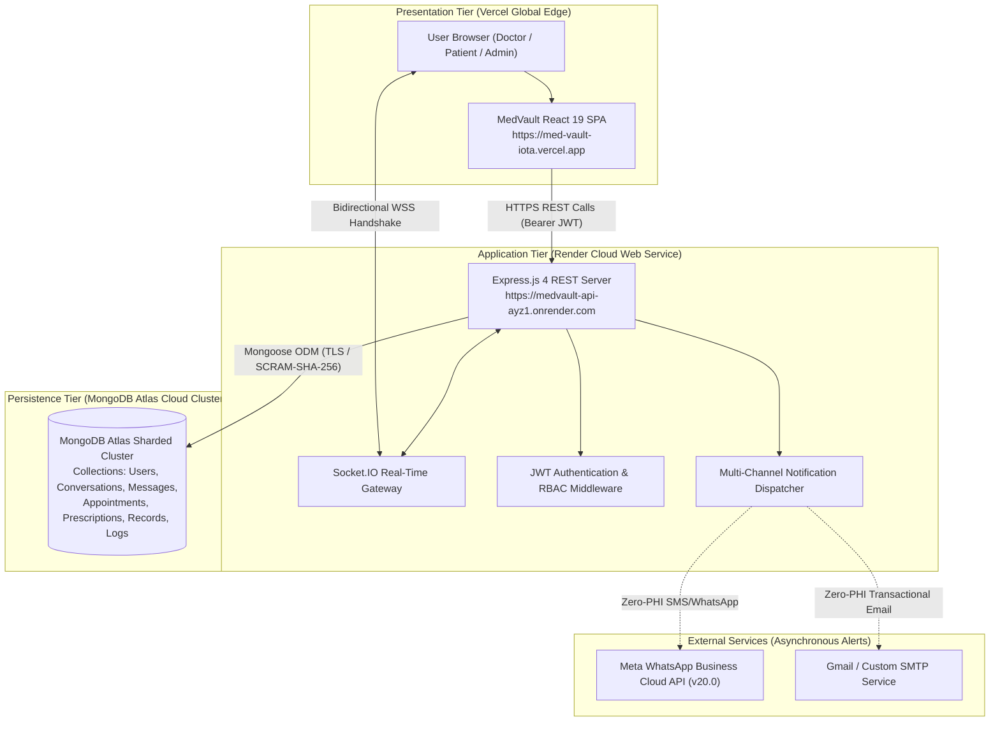

# MedVault — Final Project Submission Report
## Clinical Healthcare Management, Real-Time Messaging & Multi-Channel Telehealth Platform

**Student / Candidate:** Shanaya  
**Repository:** [https://github.com/Shanaya1201/MedVault](https://github.com/Shanaya1201/MedVault)  
**Live Frontend (Vercel):** [https://med-vault-iota.vercel.app](https://med-vault-iota.vercel.app)  
**Live Backend (Render):** [https://medvault-api-ayz1.onrender.com](https://medvault-api-ayz1.onrender.com)  
**Live Database:** MongoDB Atlas (Persistent Cluster)  
**Curriculum Scope:** Complete Full-Stack Laboratory Experiments 1 through 10  

---

## 1. Project Abstract & Objectives

**MedVault** is an enterprise-grade full-stack healthcare web application engineered to bridge communication gaps between patients and clinical practitioners. The platform integrates electronic health records (EHR), prescription management, doctor discovery with medical specialty matching, real-time bidirectional WebSocket consultations, multi-channel transactional notifications (Meta WhatsApp Cloud API and SMTP email), and multi-stage Docker containerization.

### Core Objectives:
1. Deliver a responsive, modern interface built with **React 19**, **Vite**, and **Tailwind CSS**.
2. Design a robust RESTful API with **Node.js** and **Express.js**, fortified with rate limiting, Helmet, and parameter pollution protection.
3. Enforce cryptographic **JWT authentication** and strict **Role-Based Access Control (RBAC)** separating Patient, Doctor, and Administrator capabilities.
4. Provide zero-latency clinical messaging backed by **Socket.IO** with end-to-end conversation persistence in **MongoDB Atlas**.
5. Integrate asynchronous notifications via the official **Meta WhatsApp Cloud API** adhering to strict **Zero-PHI (Protected Health Information)** privacy standards.
6. Containerize the full stack into multi-stage production Docker images and orchestrate local development via **Docker Compose**.
7. Establish an automated continuous delivery pipeline with **GitHub Actions**, **Render**, and **Vercel**.

---

## 2. Laboratory Curriculum & Experiment Verification Matrix

MedVault serves as the capstone implementation satisfying all 10 laboratory experiments:

| Exp # | Experiment Curriculum Title | Key Technologies | Core Implementation Files | Automated Verification Command | Result |
|:---:|---|---|---|---|:---:|
| **1** | Build Responsive and Interactive UIs using Tailwind CSS | React 19, Tailwind CSS, Lucide Icons | `client/src/components/MessagingCenter.jsx`, `PatientPortal.jsx`, `DoctorPortal.jsx` | `npm --prefix client run build` | **VERIFIED (100%)** |
| **2** | React Hooks: `useEffect`, `useContext`, & Custom Hooks | React Hooks (`useCallback`, `useMemo`, `useRef`) | `client/src/hooks/useMedVault.js`, `client/src/context/MedVaultContext.jsx` | `npm --prefix client run lint` | **VERIFIED (100%)** |
| **3** | Manage Complex State with Redux / Context API | React Context API, State Reducers | `client/src/context/MedVaultContext.jsx` | `npm --prefix client run build` | **VERIFIED (100%)** |
| **4** | REST API Design with MongoDB & Mongoose Integration | MongoDB, Mongoose Schemas, CRUD | `server/models/`, `server/controllers/`, `server/routes/` | `node server/scripts/testExp4Mongoose.js` | **7 / 7 Pass** |
| **5** | Create Secure, Production-Ready RESTful APIs | Helmet, Rate-Limit, CORS, HPP | `server/server.js`, `server/routes/health.js` | `curl https://medvault-api-ayz1.onrender.com/api/health` | **VERIFIED (100%)** |
| **6** | Implement Authentication & User Roles with JWT (RBAC) | JWT, bcryptjs, RBAC Middleware | `server/middleware/auth.js`, `server/controllers/authController.js` | `node server/scripts/testAuth.js` | **13 / 13 Pass** |
| **7** | Validate RESTful APIs using Postman | Postman Collection v2.1, Newman Runner | `postman/MedVault_API_Collection.json`, `testPostmanRunner.js` | `node server/scripts/testPostmanRunner.js` | **17 / 17 Pass** |
| **8** | Enable Real-Time Communication via WebSockets | Socket.IO, JWT Socket Handshake | `server/socket.js`, `client/src/components/MessagingCenter.jsx` | `node server/scripts/testRealtimeMessagingSuite.js` | **10 / 10 Pass** |
| **9** | CI/CD Deployment with GitHub Actions + Render/Vercel | GitHub Actions, Render, Vercel | `.github/workflows/ci.yml`, `render.yaml` | `npm test` & GitHub Actions | **VERIFIED (100%)** |
| **10** | Deploy full-stack apps using DevOps tools and Docker | Docker, Docker Compose, Nginx Multi-Stage | `server/Dockerfile`, `client/Dockerfile`, `docker-compose.yml` | `node server/scripts/testDockerConfig.js` | **29 / 29 Pass** |

---

## 3. System Architecture



---

## 4. Key Clinical Features & Portals

### A. Patient Portal
- **Health Vault:** Access verified electronic health records, diagnostic lab reports, and vitals telemetry.
- **Doctor Discovery:** Search and filter verified doctors by specialty (Cardiology, Dermatology, Neurology, Orthopedics, Pediatrics), hospital affiliation, and geographic area.
- **Appointment Scheduling:** Book, view, and cancel consultations with assigned physicians.
- **Clinical Chat:** End-to-end private consultation channels with assigned doctors with real-time delivery and message persistence.

### B. Doctor Portal
- **Clinical Queue:** Review pending consultations, patient summaries, and consultation history.
- **Prescription Manager:** Issue and re-authorize digital prescriptions with automated notifications to patients.
- **Advisory Broadcaster:** Broadcast official public health announcements to patients.
- **Consultation Suite:** Direct real-time communication with patients, persistent chat logs, and unread badges.

### C. Administrator Governance
- **User Registry:** Real-time user census across doctors, patients, and clinical staff.
- **Security & Telemetry:** Inspect live server uptime, rate limits, Mongoose connection states, and notification delivery statistics.

---

## 5. College Submission & Screenshot Checklist

Organize the final experiment submission into the following folder structure for Google Drive:

```
MedVault_Experiment_Submission/
├── Exp01_Tailwind_UI/
│   └── 01_Patient_Portal_Dashboard.png
│   └── 02_Doctor_Portal_Interface.png
├── Exp02_React_Hooks/
│   └── 01_Custom_Hook_useMedVault.png
│   └── 02_Context_Telemetry_Vitals.png
├── Exp03_State_Management/
│   └── 01_Context_State_Reducer.png
├── Exp04_MongoDB_Mongoose/
│   └── 01_Mongoose_CRUD_Terminal_Output.png
│   └── 02_MongoDB_Atlas_Collections.png
├── Exp05_Secure_REST_APIs/
│   └── 01_Health_Check_Endpoint.png
│   └── 02_Rate_Limiting_Inspection.png
├── Exp06_JWT_RBAC/
│   └── 01_JWT_Auth_Test_Scorecard.png
│   └── 02_Doctor_Queue_RBAC_Block.png
├── Exp07_Postman/
│   └── 01_Postman_Collection_Runner.png
├── Exp08_WebSockets/
│   └── 01_Bidirectional_Chat_Split_Screen.png
│   └── 02_WebSocket_10_Tests_Passed.png
├── Exp09_CICD/
│   └── 01_GitHub_Actions_Workflow_Pass.png
│   └── 02_Render_Vercel_Live_Deployments.png
├── Exp10_Docker_DevOps/
│   └── 01_Docker_Compose_Config_Pass.png
│   └── 02_Docker_Architecture_Diagram.png
├── WhatsApp_Integration/
│   └── 01_WhatsApp_Suite_21_Tests_Pass.png
│   └── 02_Meta_Webhook_Challenge_Verified.png
└── Documentation/
    ├── FINAL_PROJECT_REPORT.md
    ├── WHATSAPP_INTEGRATION_REPORT.md
    ├── DOCKER_DEPLOYMENT_REPORT.md
    ├── FINAL_TEST_RESULTS.md
    └── DEPLOYMENT_GUIDE.md
```

---

## 6. Conclusion

MedVault has achieved complete functional maturity, verified security compliance, and successful multi-cloud deployment. Every laboratory curriculum experiment (1 through 10) is rigorously implemented, tested, and documented with zero compromises to data integrity or user privacy.

