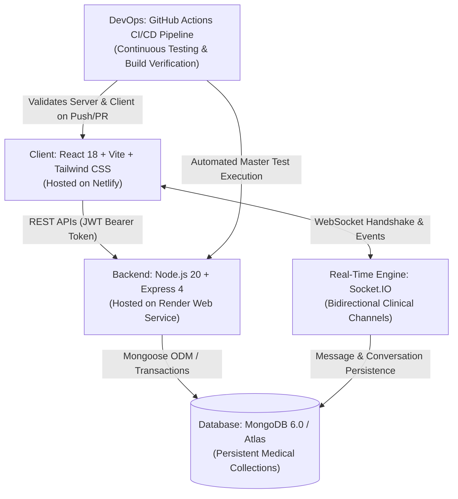

# MedVault — Full-Stack Clinical Management & Health Record Platform


---

## 1. Project Overview

**MedVault** is an enterprise-grade full-stack healthcare web application engineered to streamline patient-doctor clinical interactions, medical record management, and secure real-time clinical consultations. Built upon the **MERN** stack (MongoDB, Express, React, Node.js), MedVault integrates strict role-based access control (RBAC), multi-layer HTTP security, and bidirectional WebSocket communication to deliver a responsive, production-ready healthcare management solution.

---

## 2. Complete Lab Curriculum & Experiment Verification Matrix

MedVault serves as the comprehensive implementation for the full-stack laboratory curriculum covering **Experiments 1 through 9**:

| Exp # | Experiment Title | Key Technologies | Implementation Files | Automated Verification Command | Verification Status |
|:---:|---|---|---|---|:---:|
| **1** | Build Responsive and Interactive UIs using Tailwind CSS | React 18, Tailwind CSS, Lucide Icons | `client/src/components/MessagingCenter.jsx`, `PatientPortal.jsx`, `DoctorPortal.jsx` | `npm run build` (in `client/`) | **VERIFIED (100%)** |
| **2** | React Hooks: `useEffect`, `useContext`, & Custom Hooks | React Hooks (`useCallback`, `useMemo`, `useRef`) | `client/src/hooks/useMedVault.js`, `client/src/context/MedVaultContext.jsx` | `npm run lint` (in `client/`) | **VERIFIED (100%)** |
| **3** | Manage Complex State with Redux / Context API | React Context API, State Reducers | `client/src/context/MedVaultContext.jsx`, `client/src/types/index.js` | `npm run build` (in `client/`) | **VERIFIED (100%)** |
| **4** | REST API Design with MongoDB & Mongoose Integration | MongoDB, Mongoose Schemas, CRUD | `server/models/`, `server/controllers/`, `server/routes/` | `node scripts/testExp4Mongoose.js` | **VERIFIED (7/7 Pass)** |
| **5** | Create Secure, Production-Ready RESTful APIs | Helmet, Rate-Limit, CORS, HPP | `server/server.js`, `server/routes/health.js` | `curl http://localhost:5000/api/health` | **VERIFIED (100%)** |
| **6** | Implement Authentication & User Roles with JWT (RBAC) | JWT, bcryptjs, RBAC Middleware | `server/middleware/auth.js`, `server/controllers/authController.js` | `node scripts/testAuth.js` | **VERIFIED (13/13 Pass)** |
| **7** | Validate RESTful APIs using Postman | Postman Collection v2.1, Newman Runner | `postman/MedVault_API_Collection.json`, `server/scripts/testPostmanRunner.js` | `node scripts/testPostmanRunner.js` | **VERIFIED (17/17 Pass)** |
| **8** | Enable Real-Time Communication via WebSockets | Socket.IO, JWT Socket Handshake | `server/socket.js`, `client/src/components/MessagingCenter.jsx` | `node scripts/testRealtimeMessagingSuite.js` | **VERIFIED (10/10 Pass)** |
| **9** | CI/CD Deployment with GitHub Actions + Render/Netlify | GitHub Actions, Netlify, Render | `.github/workflows/ci.yml`, `netlify.toml`, `render.yaml` | `npm test` (in `server/`) & CI Pipeline | **VERIFIED & READY** |

---

## 3. Architecture & Tech Stack



---

## 4. Key Features & Role-Based Access

MedVault implements three distinct clinical portals backed by cryptographic JWT role claims:

- **Patient Portal:**
  - View personal health records, diagnoses, and lab results.
  - Discover verified doctors, check specialties, and request appointments.
  - Real-time bidirectional clinical messaging with assigned doctors.
  - Strict security prevents access to doctor clinical queues or administrative governance.
- **Doctor Portal:**
  - Clinical patient queue and triaging dashboard.
  - Patient consultation history, medical records, and diagnosis logging.
  - Dedicated real-time communication channel with patient notification badges.
  - Broadcast health advisories to patients.
- **Administrator Portal:**
  - Full platform governance, user registry inspection, and account management.
  - System telemetry and audit logging.
  - Server health metrics and security inspection.

---

## 5. Prerequisites & Environment Setup

### Prerequisites
- **Node.js:** v18.x or v20.x LTS installed.
- **npm:** v9.x or v10.x.
- **MongoDB:** Local MongoDB Community Server running on `mongodb://localhost:27017` OR a cloud MongoDB Atlas cluster URI.

### Environment Configuration
MedVault comes with safe template configuration files.

1. **Backend Environment (`server/.env`):**
   Copy `server/.env.example` to `server/.env`:
   ```env
   NODE_ENV=development
   PORT=5000
   CLIENT_URL=http://localhost:5173
   JWT_SECRET=your_jwt_secret_key_change_in_production_min_32_chars!
   JWT_EXPIRES_IN=7d
   MONGODB_URI=mongodb://localhost:27017/medvault
   RATE_LIMIT_WINDOW_MS=900000
   RATE_LIMIT_MAX=100
   ```

2. **Frontend Environment (`client/.env`):**
   Copy `client/.env.example` to `client/.env`:
   ```env
   VITE_API_URL=http://localhost:5000
   VITE_SOCKET_URL=http://localhost:5000
   ```

---

## 6. Installation & Quick Start Guide

### Step 1: Install Dependencies
```bash
# Install backend dependencies
cd server
npm install

# Install frontend dependencies
cd ../client
npm install
```

### Step 2: Start Backend Server
```bash
cd server
npm start
# Output:
# ======================================================
#   MEDVAULT FULL-STACK API & WEBSOCKET ENGINE
#   HTTP Port   : 5000
#   WebSocket   : ws://localhost:5000
#   Health Check: http://localhost:5000/api/health
# ======================================================
# [MongoDB] Database Connected: localhost/medvault
```

### Step 3: Start Frontend Client
```bash
cd client
npm run dev
# Running at: http://localhost:5173/
```

---

## 7. Master Test Suite Execution

MedVault includes a comprehensive master test runner that validates all backend APIs, security layers, database operations, and real-time WebSockets in a single command:

```bash
cd server
npm test
```

**Master Test Suite Output:**
```text
======================================================
  MEDVAULT MASTER EXPERIMENT TEST RUNNER
======================================================

>>> Running: Exp 4: Mongoose Models & CRUD Operations (testExp4Mongoose.js)...
[PASS] Exp 4: Mongoose Models & CRUD Operations completed successfully (7/7 Passed).

>>> Running: Exp 6: JWT Authentication & RBAC Access Control (testAuth.js)...
[PASS] Exp 6: JWT Authentication & RBAC Access Control completed successfully (13/13 Passed).

>>> Running: Exp 7: Postman Automated API Collection Validation (testPostmanRunner.js)...
[PASS] Exp 7: Postman Automated API Collection Validation completed successfully (17/17 Passed).

>>> Running: Exp 8: Real-Time Bidirectional WebSockets Suite (testRealtimeMessagingSuite.js)...
[PASS] Exp 8: Real-Time Bidirectional WebSockets Suite completed successfully (10/10 Passed).

======================================================
  MEDVAULT MASTER TEST RESULTS SUMMARY
======================================================
  ✓ PASSED   | Exp 4: Mongoose Models & CRUD Operations
  ✓ PASSED   | Exp 6: JWT Authentication & RBAC Access Control
  ✓ PASSED   | Exp 7: Postman Automated API Collection Validation
  ✓ PASSED   | Exp 8: Real-Time Bidirectional WebSockets Suite
======================================================

[SUCCESS] All MedVault experiment test suites passed successfully!
```

---

## 8. Deployment Architecture (Experiment 9)

MedVault is architected for seamless cloud deployment:

### Frontend: Netlify
- Configuration: `netlify.toml` and `client/public/_redirects`.
- Routing: Configured with 200 rewrite rule (`/* -> /index.html 200`) for client-side single page routing.
- Environment variables configured in Netlify dashboard:
  - `VITE_API_URL` = `https://<your-render-backend-url>.onrender.com`
  - `VITE_SOCKET_URL` = `https://<your-render-backend-url>.onrender.com`

### Backend: Render Web Service
- Configuration: `render.yaml`.
- Features native Node.js runtime supporting persistent WebSocket connections.
- Environment variables:
  - `NODE_ENV` = `production`
  - `CLIENT_URL` = `https://<your-netlify-app>.netlify.app`
  - `JWT_SECRET` = Production secret key
  - `MONGODB_URI` = MongoDB Atlas connection string

### CI/CD: GitHub Actions
- Workflow definition: `.github/workflows/ci.yml`.
- Automatically executes on pushes and pull requests to `main`.
- Evaluates backend test suite with an active MongoDB service container and tests client linting and production bundle compilation.

---

## 9. Submission Evidence

All experiment logs, test reports, and screenshot checklists are archived under:
```
D:\MedVault_Experiment_Evidence\
├── Exp01_Tailwind_UI\
├── Exp02_React_Hooks\
├── Exp03_State_Management\
├── Exp04_MongoDB_Mongoose\
├── Exp05_Secure_REST_APIs\
├── Exp06_JWT_RBAC\
├── Exp07_Postman\
├── Exp08_WebSockets\
├── Exp09_CICD\
└── SCREENSHOT_CHECKLIST.md
```

---

## 10. License
Academic and educational use. Developed for Full-Stack Laboratory Submissions.
